# P3R 规划 · 日程、提示、人格面具全书与合体

离线运行的 Android 应用 + 桌面小组件。根据你**现在的存档状态**和想 MAX 的社群，把从今天到 1 月 31 日的**每一个白天和晚上**都排好，并且整份安排前后自洽：每一步对现金、个人能力值（学力/魅力/勇气）、社群 RANK、解锁进度和塔尔塔罗斯次数的影响都会推演下去，后面的安排建立在前面的结果之上。

先满足你选的目标，剩下的时间默认「尽量都体验」：先解锁社群、均衡升级，再冲 MAX。

## 截图

<p>
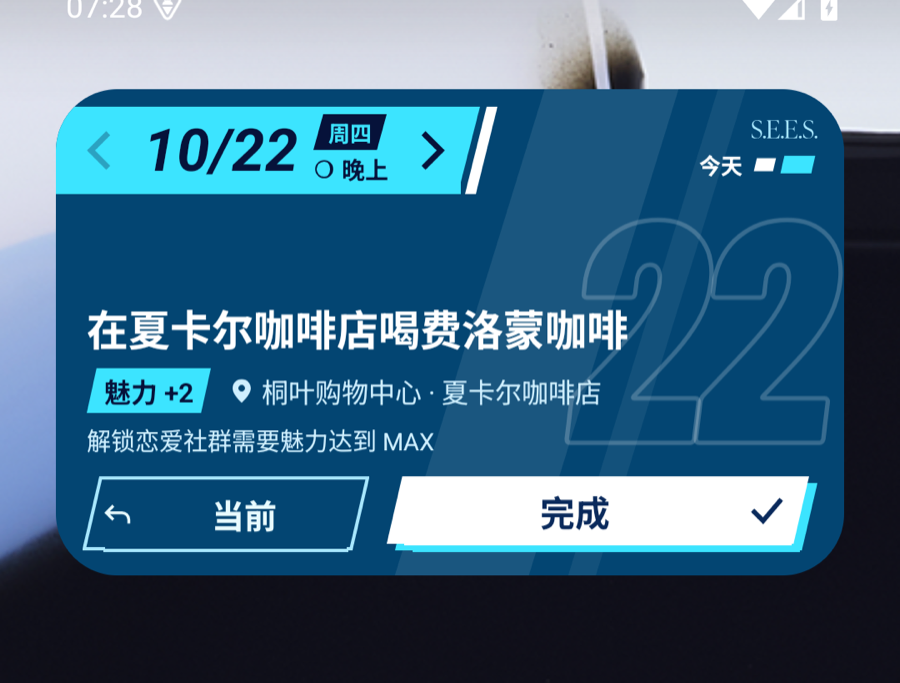
</p>
<p>
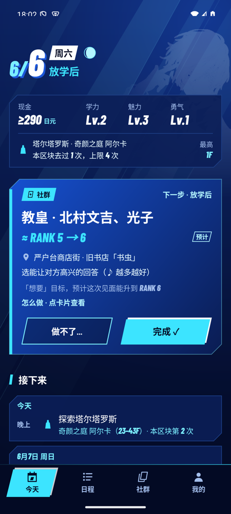
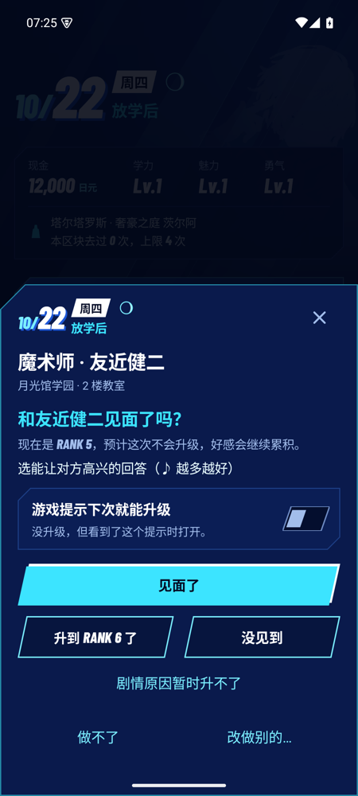
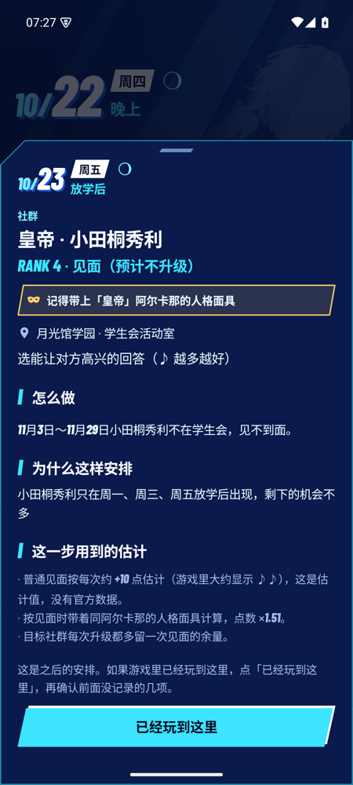
</p>
<p>
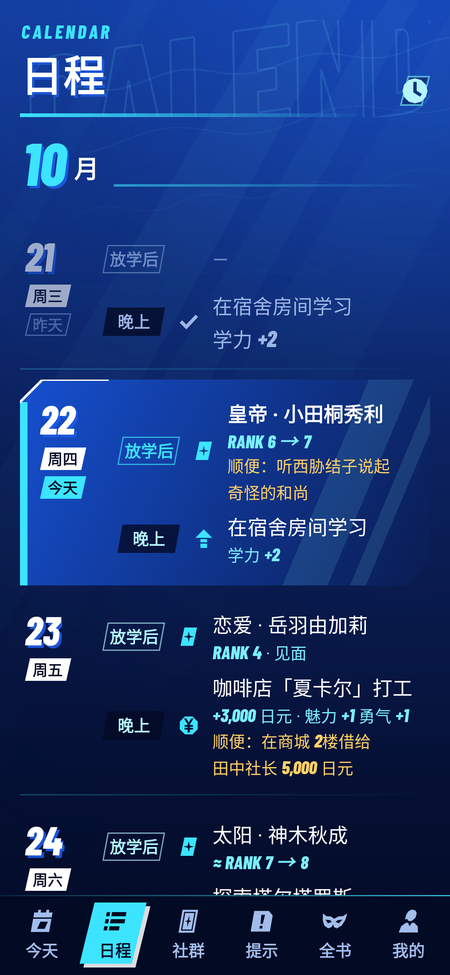
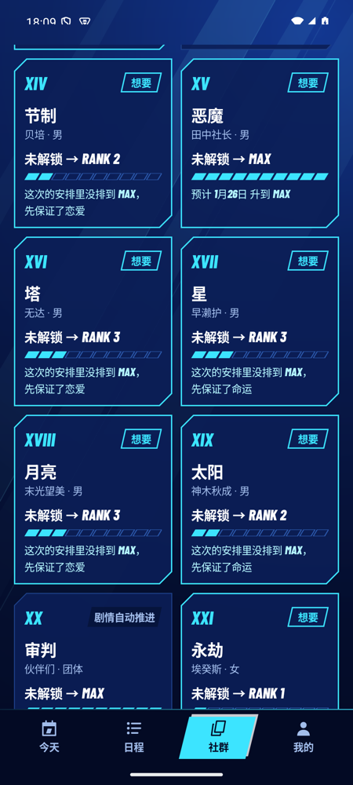
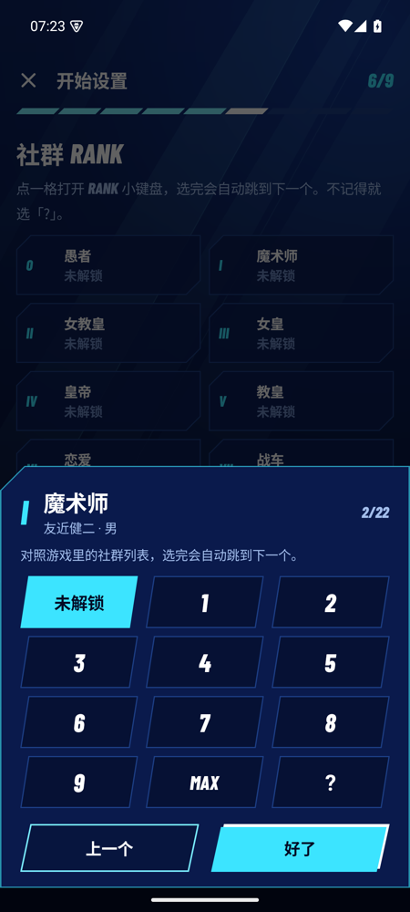
</p>
<p>
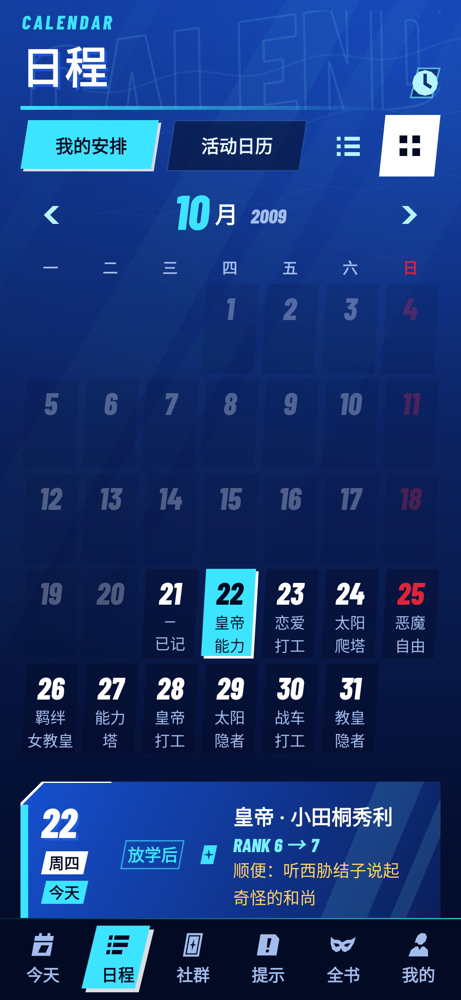
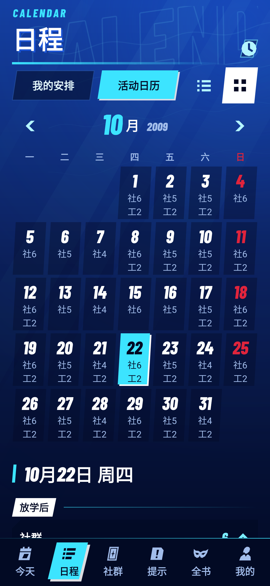
</p>
<p>
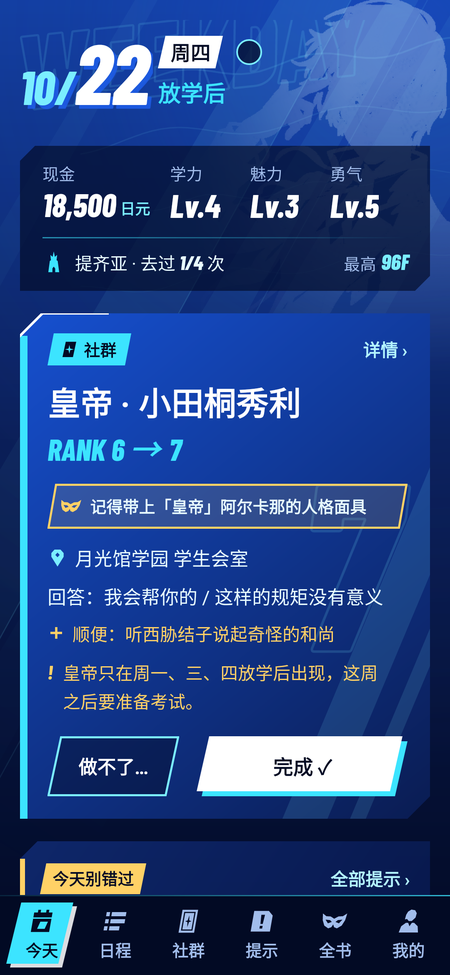
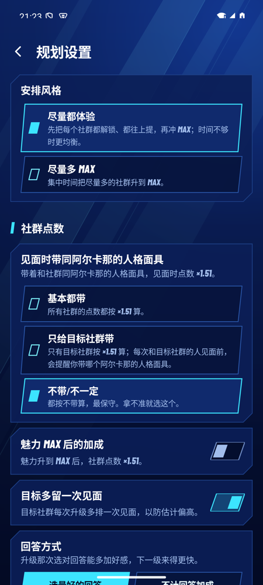
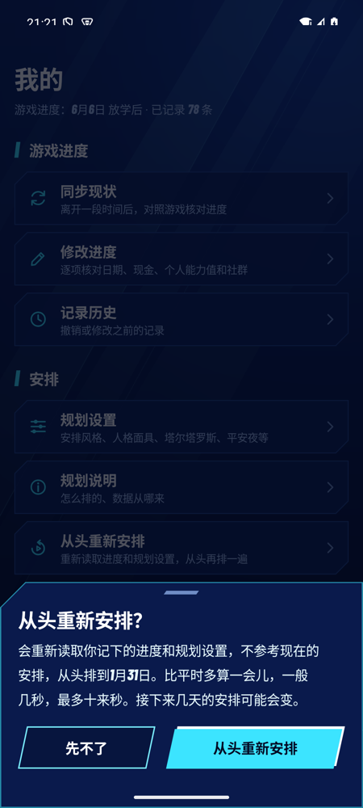
</p>
<p>
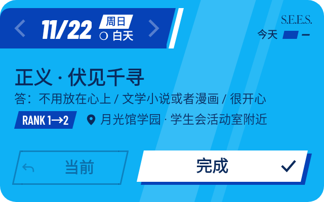
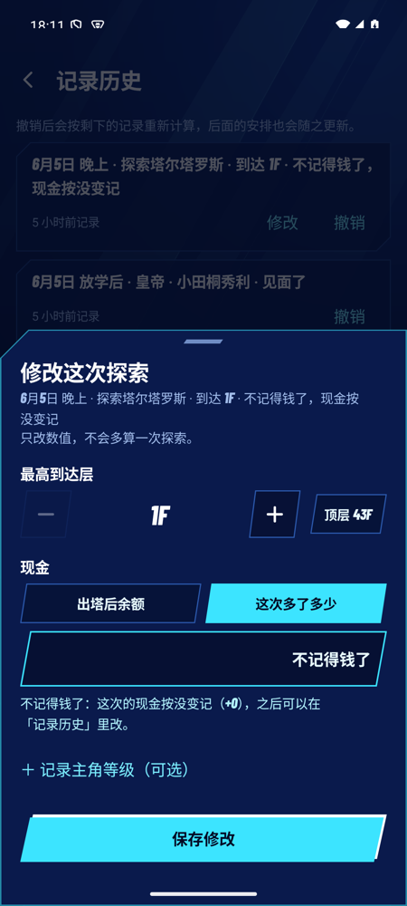
</p>
<p>
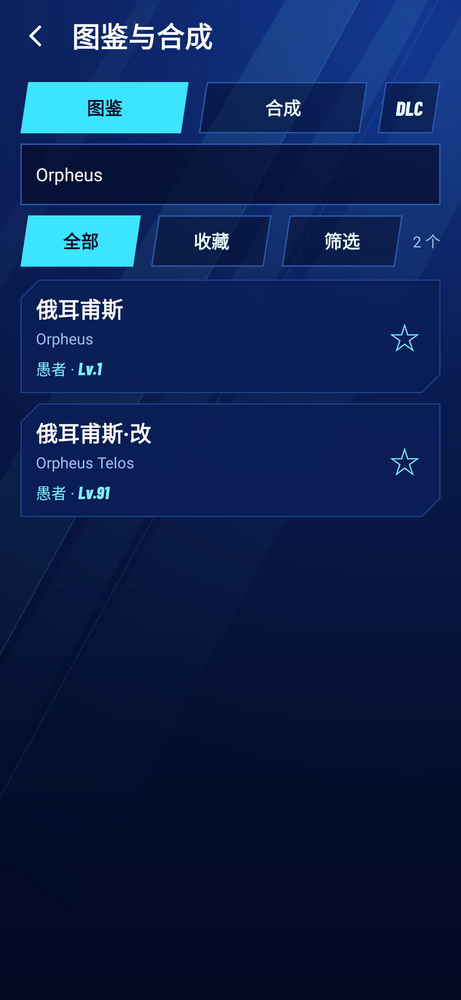
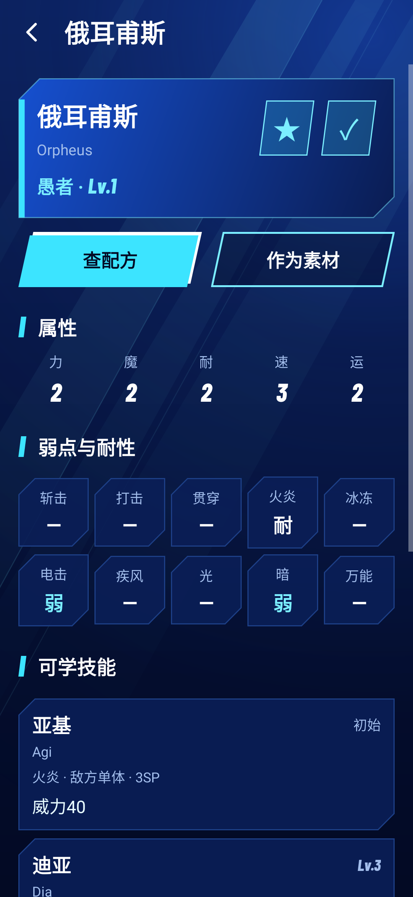
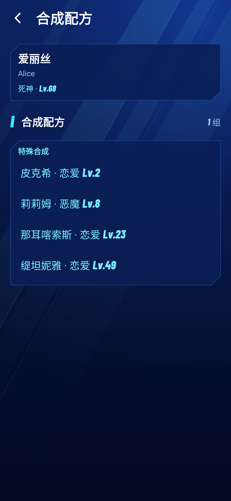
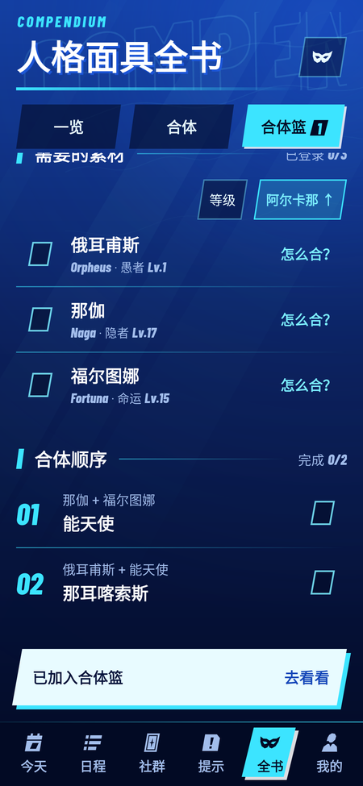
</p>
<p>
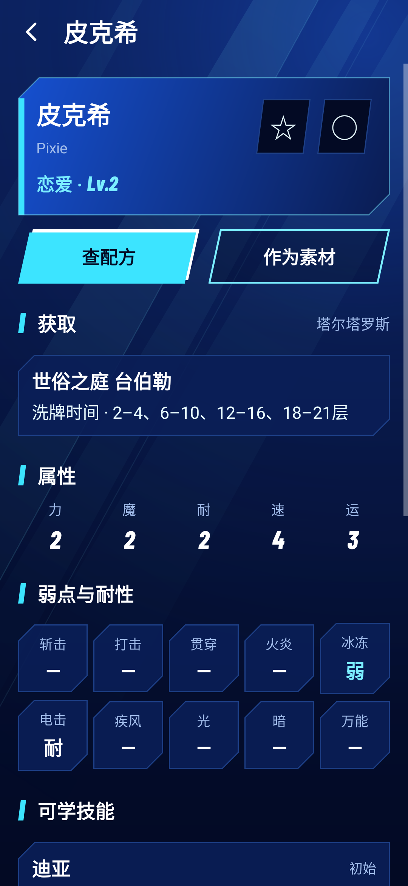
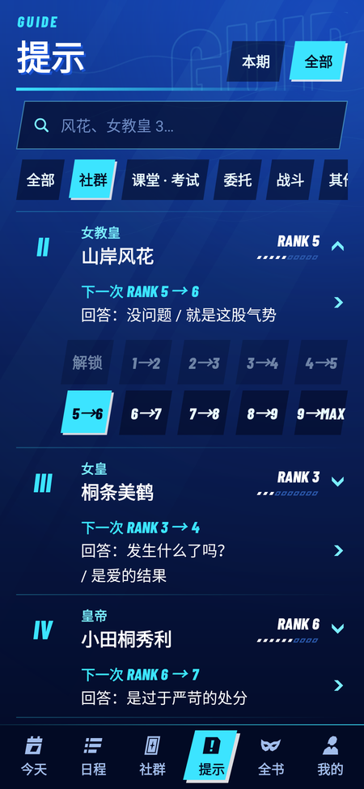
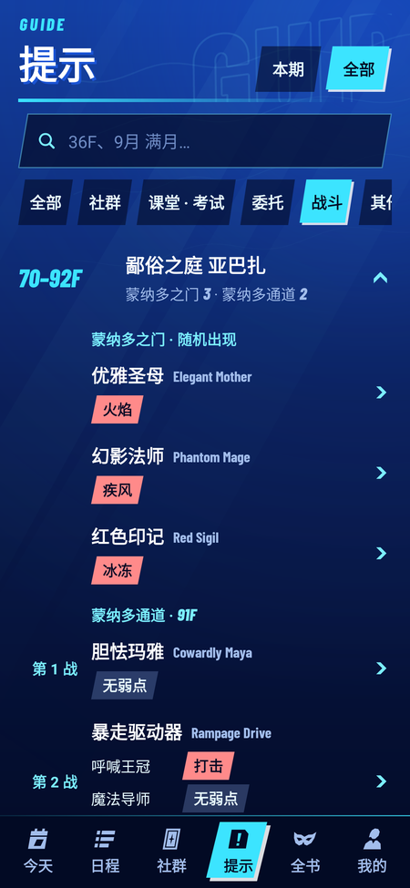
</p>

## 下载

下载正式版 [P3R-Planner-3.6.3.apk](https://github.com/nobrainmonkey/P3R_widget/releases/download/v3.6.3/P3R-Planner-3.6.3.apk)，在手机上打开安装即可（需要允许“安装未知应用”）。完整说明和校验文件见 [3.6.3 Release](https://github.com/nobrainmonkey/P3R_widget/releases/tag/v3.6.3)。

**正式版安装**：[3.6.3](docs/RELEASE_NOTES_3.6.3.md) 将可展开菜单统一默认折叠，手动展开后当前页面刷新会保留状态。沿用 3.3.0 签名，可以直接覆盖 3.3.0 及以后的版本并保留进度。已有存档可在「社群 → 羁绊剧情」选择安排绫时。3.2.0 及更早版本的更新步骤见[签名与迁移说明](docs/RELEASE_SIGNING.md)。

**从 3.0.x 更新**：3.1.0 去掉了「我的 → 逐日攻略」，更新后就看不到它的打勾进度了。想保留的话，**更新前**先打开逐日攻略，点右上角的菜单按钮打开「设置」，再点「导出进度备份」（这个文件可以导入旧版 2.0.0 “P3R” 的固定攻略）。已经更新了也不要紧：打勾进度并没有被删除，仍然留在手机上；从 3.1.1 起，「我的 → 备份与恢复」里有「旧版逐日攻略」一节，点「导出打勾进度」就能导出同样的文件（手机上没有打过勾的进度时，不会显示这一节）。桌面上的「P3R 逐日攻略」小组件更新后会失效，长按移除即可；「P3R 每日安排」不受影响。

**关于旧版本（2.0.0 “P3R”）**：新版的包名是 `app.p3r.planner`，会作为一个**新应用**安装，不会覆盖、也不会删除旧版的数据（旧版用的签名证书不在这里，无法原地升级）。

- 旧版「固定攻略」和它的打勾进度留在旧版里：新版只做安排，不含固定攻略，也不导入那份进度。
- 存档进度：新版第一次打开时，用设置向导把当前存档状态录一遍（日期、现金、三项能力、各社群 RANK），大约一两分钟。

## 怎么用

底部页面是「今天 / 日程 / 社群 / 提示 / 全书 / 我的」；「全书」里有一览、合体和合体篮。桌面小组件按 **5×2** 大小设计，最小使用 **4×2**；实际格距随手机桌面而异。

1. **第一次打开**：点「开始设置」，照着游戏画面填日期、现金、个人能力值和社群 RANK（中途存档还会问解锁准备、羁绊剧情、宿舍活动和失踪者），最后选目标社群（「想要」/「必须」）和见面时带不带同阿尔卡那的人格面具。
2. **每天玩的时候**：看「今天」页或桌面小组件的下一步，做完点「完成」。
   - 训练、打工：点一下就记好。
   - 和社群的人见面：「升到 RANK 7 了」/「没升级」点一个就行，升级时会出现「RANK UP!!」。需要带人格面具时会提醒你带哪个阿尔卡那。
   - 塔尔塔罗斯：填到达的最高层（点数字可以直接输入），现金填「出塔后余额」或「这次多了多少」其中一个，记不清就选「不记得了」。
   - 宿舍活动：记录做了哪一项；同一项目做满 3 次解锁队友特性，两种项目各做满 3 次强化特性。
   - 顺便要做的事（比如给田中社长付款）会写在同一项里，不会消耗时间。
   - 见面时该选哪句：小组件和「今天」直接写「回答：…」；课堂提问和考试的答案也写在当天。
   - **今天别错过**：不会消耗时间但值得做的事会在当天提醒——课堂提问和考试的答案、上课犯困时闭不闭眼、去保健室、电视购物、伊莉莎白的新委托和截止日期、失踪者、黄昏的碎片、新开的店。
   - **今天可做**：查当天还能参加的羁绊剧情、宿舍活动、打工、营业场所和电玩城内容，包括人格面具的力、魔、速训练，直接看对象、收益和费用。
3. **没照安排走**：点「做不了…」选原因或实际做的事，后面会自动重新安排。
   - **刚才点错了**：「日程」里点开那天，或打开「我的 → 记录历史」，选「修改」或「撤销」。
   - **想自己查日期**：「日程」可切换列表和网格月历；「我的安排」看规划，「活动日历」查每天开放的社群、宿舍活动、打工、营业、电玩城和解锁事项。
4. **很久没记录**：「今天」会问「之后又玩了吗？」，点「同步现状」。基本照着安排玩的话，填今天的游戏日期再核对一下就行；只改了一两项可以用「我的 → 修改进度」，点要改的那一项。
5. **社群**：分成「社群」「羁绊剧情」「队友特性」。点社群卡片可以改目标（想要 / 必须）、朋友或恋人路线；「目标顺序」调整先后。队友特性里可以选「解锁 / 强化」，也可以开启「种菜也排进来」（记得先买好种苗种下去）。
6. **提示**：「本期」显示这次塔尔塔罗斯开放到下次开放前的事项，「全部」可以查找全部委托、战斗、社群答案和课堂／考试答案；标签一点就筛选（社群、课堂 · 考试、委托、战斗、其他），支持编号、名称和楼层搜索。社群对话直接显示下一次 RANK 的回答，朋友／恋人分开显示。
7. **全书**：可以搜中英文名称和技能，按阿尔卡那、等级筛选和排序。面具资料里有相性、技能、合体配方和塔内取得的楼层；星星是收藏，勾表示已登录、可召唤。先勾选已购买的面具 DLC，结果会按你的组合变化。
8. **合体篮**：把想合的面具加进合体篮。例如 A 需要 B＋C，缺少 C 时再为 C 选 D＋E，合体篮会列出召唤清单和先 C、后 A 的合体顺序。收藏、登录情况、合体篮和 DLC 都会随备份保存。
9. **规划设置**：「尽量都体验」（默认）或「尽量多 MAX」，人格面具，塔尔塔罗斯每个区块去几次，手上至少留多少钱，其余社群也尽量提升等；「更多选项」里有「仔细重新安排」（每次更新多等十来秒）。
10. **想从头再排一遍**：「我的 → 从头重新安排」，最多半分钟，期间可以照常记录。

所有记录都能撤销（「我的 → 记录历史」），之后改目标或人格面具设置也不会改写已经确认过的记录。

## 安排是怎么算的

- 按时间顺序完整推演整个日历，每个时段只做一件事；每一步的结果（钱、个人能力值、RANK、解锁进度、塔尔塔罗斯次数）都会带到后面。
- 需要付钱解锁的社群（比如恶魔社群的三次付款）：交完钱手上至少还留 2,500 日元；快到交钱的时候，花钱提升能力和买结缘网站的字条都不会动用要交的钱。只有晚交会赶不上升级目标时，才会留得比这少。
- 三维训练和解锁资金跟随「必须／想要」目标。多个「必须」需要的前置会一起准备，按实际开放日期、缺口和剩余训练机会决定先后；不会因为目标排在后面，就等前一个 MAX 才开始练它需要的属性。
- 校内社群共用的上学日会单独计算竞争：能在暑假、假期推进的校外社群，优先使用那些日期。11 月后的结缘字条按能省下多少白天见面计分，也保留多张累积补好感的价值；有可用的后续见面才安排。
- 进塔会考虑所有失踪者的出现日期和期限，尽量等同一期的人到齐后一起救；可行时留出截止前一天的余量，并遵守每区块的探索次数设置。
- 会根据三维和已了解的菜单选择限定餐：定食若津的水产全席套餐（魅力 Lv.3，学力 +4）和叶隐的限定餐（勇气 Lv.3，魅力 +4）。菜单尚未了解时先安排一次普通餐，日期和现金条件满足后再使用限定餐。
- 考前集体学习按 14 个限定晚上参加，免费提升学力。宿舍活动按有用的三维和相关社群好感参与安排；选了队友特性目标后，会额外考虑解锁、强化以及提早获得后能使用多久的价值，按实际活动日期推进；搜索也会比较一份优先推进特性项目的路线。目标达成后，不会再为该特性安排；仍有三维收益的项目可以继续作为免费训练。它们不花活动费，但会占用晚上。救援期限和按顺序排列的「必须／想要」社群目标仍优先；选定特性会和其余社群、训练及打工竞争，可能减少其余社群的见面机会。由加莉、风花、美鹤和埃癸斯的两项宿舍活动可补对应已解锁社群的好感，三次以后仍有效，缺口已满时停止为好感安排。
- 搜索方法：贪心基础策略 + 前瞻“滚动推演”（rollout）。每个时段比较几个候选，各自往后模拟到 1 月 31 日，选最终结果最好的那个；白天优先留给社群，能在晚上练的个人能力值不占白天，打工只在需要用钱时安排。
- 在后台计算：普通重排 4 秒，补算 8 秒；开启「仔细重新安排」后，记录或修改设置触发的自动重排给 12 秒；「从头重新安排」给 30 秒。12 秒修改完成后不再追加 8 秒补算。计算期间仍可记录进度。
- 12 秒和 30 秒计算都会先执行普通搜索并保留结果，再用剩余时间扩大行动和策略搜索；普通搜索包含在总预算内。
- **尽量都体验（默认）**：不是目标的社群，每升一级的价值递减——解锁一个新社群最值，已经很高的社群再升一级没那么值，所以安排会先把所有社群都解锁、都往上提；MAX 仍然有额外的价值。安排时还会同时算一份「尽量多 MAX」的安排来对比，保证「尽量都体验」不会在解锁数、RANK 5 以上的社群数和 RANK 合计上全面输给它。
- 见面和最终目标比较仍严格按顺序优先；加入后面的目标时，搜索也会单独检查前面目标的策略，保留兼顾前面目标的路线。属性和资金准备按目标档位及实际日期共同安排。不同存档、目标和安排风格的完整模拟结果见 [`docs/PLAN_METRICS.md`](docs/PLAN_METRICS.md)。
- 每份安排生成后都由独立的校验器检查：不重复占用时段、不在剧情日行动、不超支、不超过塔尔塔罗斯次数上限、RANK 推演一致。
- 重排时会从当前进度校验并回放旧安排的剩余部分，仍可执行的路线按当前目标和安排风格参与比较，保留适用的「从头重新安排」成果；实际进度有偏差时，剔除不合法的后续并按现状重排。
- 看不见的数值（好感点数、能力值点数）只用保守估计，并且和你确认过的进度分开保存：预计永远不会被当成已发生的事实。普通见面 +10 点是估计值（游戏里约显示 ♪♪）。

## 数据来源

优先使用从 P3R 游戏文件中提取的数据表（社群点数阈值、加成系数、能力值阈值、休息日邀约日期、塔尔塔罗斯区块开放日、官方简体中文名称），其次是 Reload 专用的社群日历和攻略站，并排除 P3/FES/P3P 的旧数据。每条规则都记录了来源和可信度，详见 `rules/build/REPORT.md` 与 `rules/sources/SOURCES.json`。

人格面具全书与合体参考 [aqiu384 / Megaten Database](https://github.com/aqiu384/megaten-database) 和 [Megaten Fusion Tools](https://github.com/aqiu384/megaten-fusion-tool)；后者代码使用 Unlicense。面具和技能优先采用游戏官方简中、英文名称，不收录图片。

## 从源码构建

所有构建依赖（JDK 17、Android SDK、Gradle 缓存）都放在项目目录内的 `.toolchain/`，不会安装到系统里。

```bash
scripts/setup_toolchain.sh
```

```bash
scripts/build_release.sh
```

产物在 `dist/`。

验证构建不依赖项目目录以外的任何东西（空环境、空 HOME、Gradle 离线模式，并检查 ~/.gradle、~/.m2、~/.android 没有新文件）：

```bash
scripts/verify_selfcontained.sh
```
发布签名密钥放在 `.signing/`（已被 git 忽略，不会上传）；正式发布脚本在缺少签名配置时会停止，私钥的备份与 CI 配置见[签名说明](docs/RELEASE_SIGNING.md)。

## 目录

| 路径 | 内容 |
|---|---|
| `android/` | Android 工程（应用和桌面小组件的代码都在 `app/src/main/java/app/p3r/dayplanner/v3/`） |
| `rules/build/` | 规则包编译脚本，生成 `android/app/src/main/assets/p3r/p3r_rules.json` |
| `rules/p3r/`, `rules/sources/` | 规则证据与来源快照（不打包进 APK） |
| `docs/DESIGN_v3.md` | v3 设计文档 |
| `docs/DESIGN_3.6_UI.md` | 3.6 界面与文案规范（P3R 风格、用语、各页面） |
| `docs/HANDOFF_COMPLIANCE.md` | 项目要求的完成情况、复核证据与所有者决定 |
| `docs/PLAN_METRICS.md` | 各场景的安排质量（真实规则包） |
| [`docs/DEEP_SEARCH_AUTUMN_BENCHMARK_3.4.1.md`](docs/DEEP_SEARCH_AUTUMN_BENCHMARK_3.4.1.md) | 9／10月女性社群与太阳全必须：40份计划、整周记录和偏离后的对照 |
| [`docs/DEEP_SEARCH_BENCHMARK_3.4.1.md`](docs/DEEP_SEARCH_BENCHMARK_3.4.1.md) | 原始中途／晚期样本，保留作尾段重排与救援回归 |
| [`docs/TRAIT_TIMING_BENCHMARK_3.6.0.md`](docs/TRAIT_TIMING_BENCHMARK_3.6.0.md) | 十月底存档的队友特性时间、必须社群与救援对比 |
| [`docs/AVAILABILITY_CALENDAR.md`](docs/AVAILABILITY_CALENDAR.md) | 活动日历的数据与电玩城白天开放时间来源 |
| `docs/analysis/` | 代码、数据来源、对话覆盖和交互的分析报告 |
| `docs/CODEX_CONTEXT.md` | 当前架构、规则边界与开发入口 |

## 说明

非官方粉丝工具，与 ATLUS / SEGA 无关。《女神异闻录3 Reload》及相关名称、标志归其各自权利人所有。数字字体 Barlow Condensed 采用 SIL Open Font License（`docs/licenses/`），未作修改。
